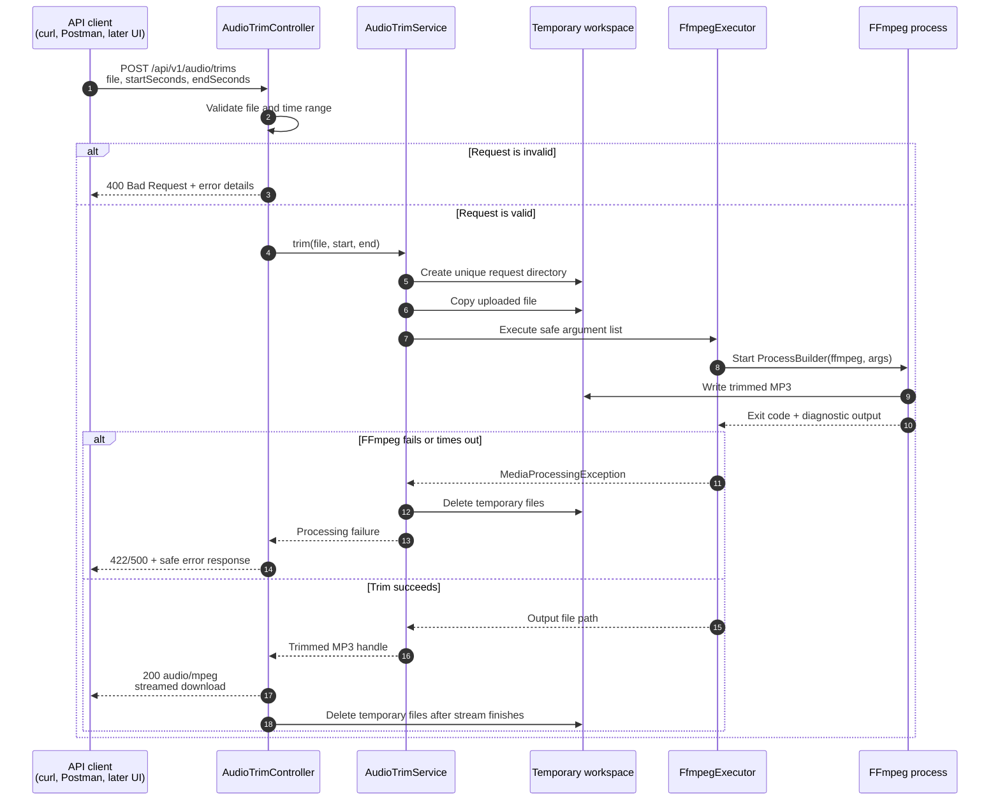

# High-level design: first milestone

## Scope

This design covers one synchronous, local action: trim a user-supplied audio file and return an MP3. It intentionally excludes persistent storage, a database, a frontend application, authentication, queues, cloud deployment, and multi-clip mixing.

## Sequence diagram



## Component responsibilities

| Component | Responsibility | Must not do |
|---|---|---|
| API client | Sends the audio file and trim range; saves returned MP3 | Decide FFmpeg arguments or access server directories |
| `AudioTrimController` | Defines the HTTP endpoint, validates request-level input, maps failures to HTTP responses, streams the finished output | Implement media commands or business logic |
| `AudioTrimService` | Orchestrates one trim request, manages temporary-file lifecycle, verifies output exists | Know HTTP-specific response details |
| `FfmpegExecutor` | Runs FFmpeg via `ProcessBuilder`, captures output, enforces timeout, translates process errors | Construct application workflow or trust raw user strings as commands |
| FFmpeg | Reads the input audio and writes the requested trimmed MP3 | Maintain projects, users, or job state |
| Temporary workspace | Holds one request's input and output only for as long as needed | Become permanent storage |

## Request and data flow

```text
multipart upload
  → validation
  → unique temporary directory
  → FFmpeg input/output files
  → streamed MP3 response
  → workspace cleanup
```

The uploaded file never becomes a permanent application asset in this milestone. This keeps the first use case private, local, and easy to reason about.

## Key design decisions

1. **Synchronous request first.** A single short audio trim should complete within the HTTP request. Export jobs, progress updates, and a queue are deferred until real processing time proves they are necessary.
2. **One workspace per request.** It prevents filename collisions and enables reliable cleanup even when requests run at the same time.
3. **FFmpeg behind an interface.** `FfmpegExecutor` can be faked in unit tests; only a small integration test needs the real executable.
4. **Arguments, not shell strings.** `ProcessBuilder` receives an explicit argument list, reducing injection risk and making commands inspectable.
5. **MP3 output only.** A predictable output format keeps the API and manual verification simple. Input codec support can expand later.

## Failure model

| Situation | API behavior | Cleanup |
|---|---|---|
| Missing file or invalid range | `400 Bad Request` | No workspace required |
| Unsupported/invalid media | `422 Unprocessable Content` | Remove request workspace |
| FFmpeg non-zero exit | `422` with a safe processing error | Remove request workspace |
| FFmpeg timeout / unexpected I/O failure | `500 Internal Server Error` | Remove request workspace |
| Successful stream | `200 audio/mpeg` | Remove workspace after streaming completes |

## Deferred architecture

When this flow is stable, a later HLD can extend it with a React UI, Postgres project records, object storage, a job queue, background FFmpeg workers, and multi-clip rendering. None of those components are required to prove the first trimmed-MP3 workflow.
